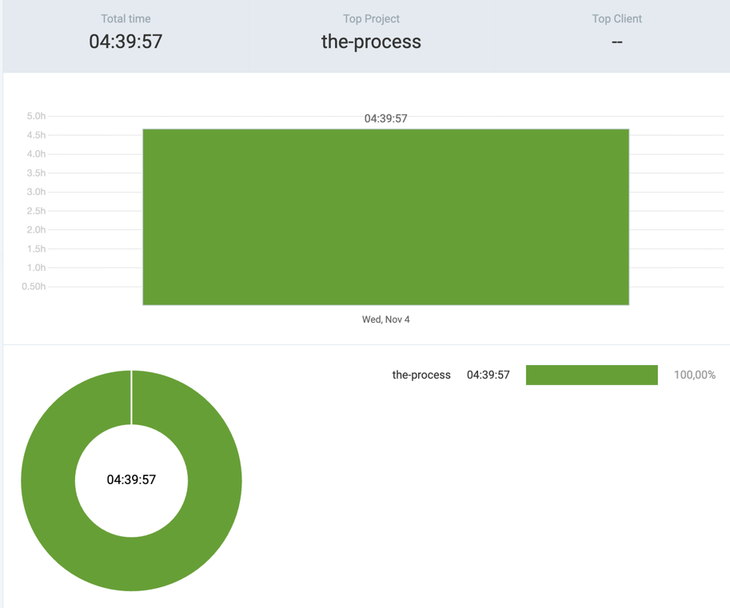

# 4th November 2026

## [the-process](https://github.com/kdklearns/the-process)
### `Neetcode 250`
- `Arrays & Hashing` &rarr; Solved five questions

| S. No.                                                                                                                         | Problem                                                                                       | Topics                            | Level  | TC     | SC         | Submissions | Time taken | My Expertise | Status   | Spaced Repetition | Note                                                                                                       |
|--------------------------------------------------------------------------------------------------------------------------------|-----------------------------------------------------------------------------------------------|-----------------------------------|--------|--------|------------|-------------|------------|--------------|----------|-------------------|------------------------------------------------------------------------------------------------------------|
| [1](../../../../src/main/java/org/kdklearns/neetcode_250/m_01_arrays_and_hashing/q_18_longest_consecutive_sequence/problem.md) | [Longest Consecutive Sequence](https://leetcode.com/problems/longest-consecutive-sequence/)   | `Arrays` `Hashing`                | Medium | `O(N)` | `O(1)`     | 5           | —          | —            | Accepted | —                 | Finding the longest consecutive sequence in linear time without sorting felt new!                          |
| [2](../../../../src/main/java/org/kdklearns/neetcode_250/m_01_arrays_and_hashing/q_17_valid_sudoku/problem.md)                 | [Valid Sudoku](https://leetcode.com/problems/valid-sudoku/)                                   | `Matrix` `Hashing`                | Medium | `O(1)` | `O(1)`     | 3           | —          | —            | Accepted | —                 | Have to learn the bit manipulation implementation as well                                                  |
| [3](../../../../src/main/java/org/kdklearns/neetcode_250/m_01_arrays_and_hashing/q_16_product_of_array_except_self/problem.md) | [Product of Array Except Self](https://leetcode.com/problems/product-of-array-except-self/)   | `Arrays` `Prefix/Suffix Products` | Medium | `O(N)` | `O(1)`     | 1           | —          | Good         | Accepted | —                 | Had an `Aha!` moment today :)                                                                              |
| [4](../../../../src/main/java/org/kdklearns/neetcode_250/m_01_arrays_and_hashing/q_15_range_sum_query_2d_immutable/problem.md) | [Range Sum Query 2D - Immutable](https://leetcode.com/problems/range-sum-query-2d-immutable/) | `Matrix` `Prefix Sum` `Design`    | Medium | `O(1)` | `O(M * N)` | 1           | —          | Good         | Accepted | —                 | Like, come on bruhh...                                                                                     |
| [5](../../../../src/main/java/org/kdklearns/neetcode_250/m_01_arrays_and_hashing/q_14_encode_and_decode_strings/problem.md)    | [Encode and Decode Strings](https://leetcode.com/problems/encode-and-decode-strings/)         | `Strings` `Design`                | Medium | `O(N)` | `O(1)`     | 6           | —          | New          | Accepted | —                 | `YEET!` Easily the most exciting problem for today. Learned about different strategies including chunking! |

## Commits
(_the-process_)
- `4c33e21` &rarr; `test > arrays & hashing > ran troublesome testcases for the day's questions`
- `55745eb` &rarr; `arrays & hashing > solved five questions Q[14, 18]; 5M, 0E, 0H`
- `165bae9` &rarr; `log > October > changed naming convention`