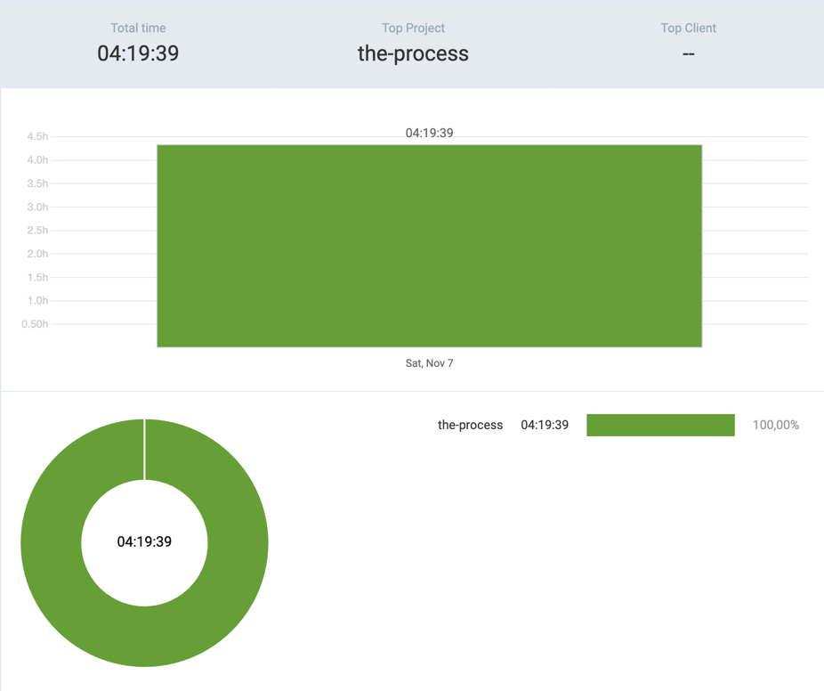

# 7th November 2026

## [the-process](https://github.com/kdklearns/the-process)

### `Neetcode 250`

- `Two Pointers` &rarr; Solved five questions, including two approaches to Trapping Rain Water

**Total recorded solving time:** `03:46:39`

| S. No.                                                                                                                | Problem                                                                               | Topics                                         | Level  | TC           | SC                       | Submissions | Time taken                       | Spaced Repetition | Note                                                                                                                                                          |
|-----------------------------------------------------------------------------------------------------------------------|---------------------------------------------------------------------------------------|------------------------------------------------|--------|--------------|--------------------------|-------------|----------------------------------|-------------------|---------------------------------------------------------------------------------------------------------------------------------------------------------------|
| [1](../../../../src/main/java/org/kdklearns/neetcode_250/m_02_two_pointers/q_11_container_with_most_water/problem.md) | [Container With Most Water](https://leetcode.com/problems/container-with-most-water/) | `Arrays` `Two Pointers`                        | Medium | `O(N)`       | `O(1)`                   | —           | `00:14:57`                       | —                 | Reminded me of Trapping Rain Water; this one felt straightforward.                                                                                            |
| [2](../../../../src/main/java/org/kdklearns/neetcode_250/m_02_two_pointers/q_12_boats_to_save_people/problem.md)      | [Boats to Save People](https://leetcode.com/problems/boats-to-save-people/)           | `Sorting` `Two Pointers` `Greedy`              | Medium | `O(N log N)` | `O(1)`                   | —           | `00:23:12`                       | —                 | Once the array was sorted, the algorithm came easily.                                                                                                         |
| [3](../../../../src/main/java/org/kdklearns/neetcode_250/m_02_two_pointers/q_13_trapping_rain_water/problem.md)       | [Trapping Rain Water](https://leetcode.com/problems/trapping-rain-water/)             | `Arrays` `Two Pointers` `Prefix/Suffix Maxima` | Hard   | `O(N)`       | A1: `O(N)` A2: `O(1)` | —           | A1: `00:23:12` A2: `00:46:40` | —                 | A1: Used an extra array to store the maximum height to the right (`r_max`). A2: My last two brain cells finally gave each other a high five. Maza aa gaya! |
| [4](../../../../src/main/java/org/kdklearns/neetcode_250/m_02_two_pointers/q_08_3_sum/problem.md)                     | [3Sum](https://leetcode.com/problems/3sum/)                                           | `Arrays` `Sorting` `Two Pointers`              | Medium | `O(N²)`      | `O(1)`                   | —           | `01:05:26`                       | —                 | Made me scratch my brain cells.                                                                                                                               |
| [5](../../../../src/main/java/org/kdklearns/neetcode_250/m_02_two_pointers/q_09_4_sum/problem.md)                     | [4Sum](https://leetcode.com/problems/4sum/)                                           | `Arrays` `Sorting` `Two Pointers`              | Medium | `O(N³)`      | `O(1)`                   | —           | `00:53:12`                       | —                 | Made me scratch my soul.                                                                                                                                      |

*Times use HH:MM:SS. The total includes A1 and A2 separately. SC describes the core approach, excluding sorting workspace, returned results, and debug output.*

## Commits

(_the-process_)

- `24e078b` &rarr; two pointers > solved five questions: Q[8,9] + Q[11, 13]
- `4458b78` &rarr; test > troubleshooted failed test cases