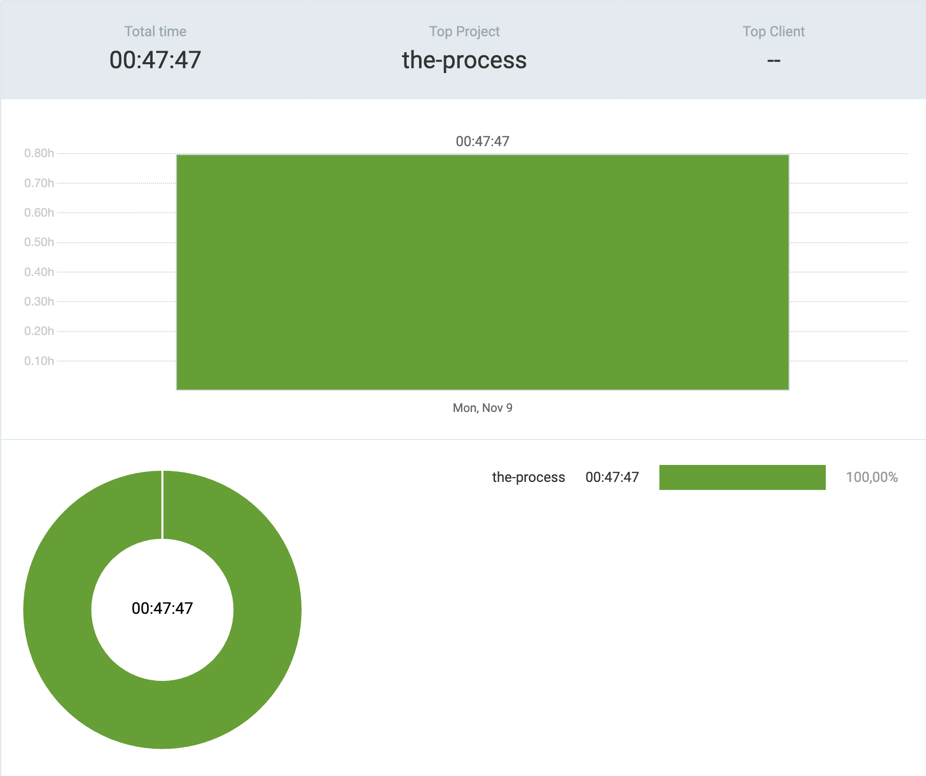

# 9th November 2026

## [the-process](https://github.com/kdklearns/the-process)

### `Neetcode 250`

- `Arrays & Hashing` &rarr; Drafted approach for two previously solved questions  

**Total recorded time:** `00:47:47`

## Commits

(_the-process_)

- `247653f` &rarr; approach & notes > (M1, Q16) Product Of Array Except Self
- `78293e9` &rarr; approach & notes > (M1, Q15) Range Sum Query