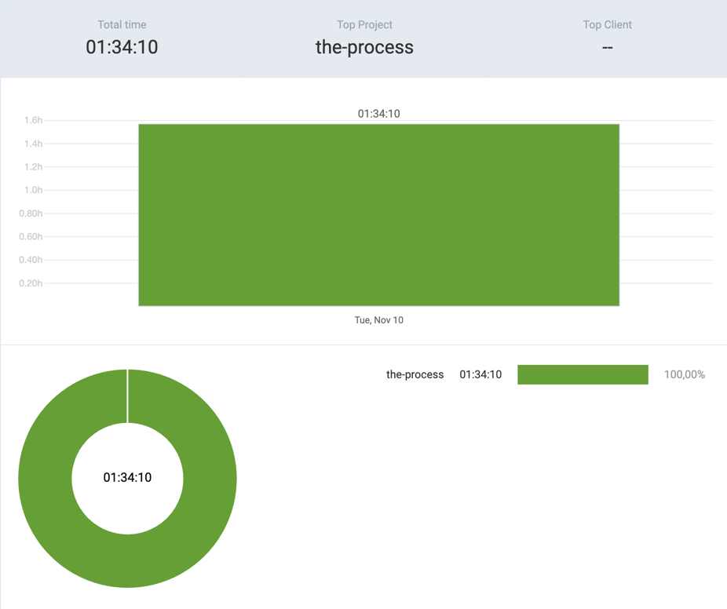

# 10th November 2026

## [the-process](https://github.com/kdklearns/the-process)

### `Neetcode 250`

- `Sliding Window` &rarr; Worked on two questions

**Total recorded solving time:** `01:06:25`

| S. No. | Problem | Topics | Level | TC | SC | Submissions | Time taken | Spaced Repetition | Note |
|--------|---------|--------|-------|----|----|-------------|------------|-------------------|------|
| [1](../../../../src/main/java/org/kdklearns/neetcode_250/m_03_sliding_window/q_01_contains_duplicate_ii/problem.md) | [Contains Duplicate II](https://leetcode.com/problems/contains-duplicate-ii/) | `Arrays` `Hashing` `Sliding Window` | Easy | `O(N)` | `O(min(N, K))` | 6 | `00:59:54` | — | Took me on a trip, this one! |
| [2](../../../../src/main/java/org/kdklearns/neetcode_250/m_03_sliding_window/q_02_best_time_to_buy_and_sell_stock/problem.md) | [Best Time to Buy and Sell Stock](https://leetcode.com/problems/best-time-to-buy-and-sell-stock/) | `Arrays` `Sliding Window` | Easy | `O(N)` | `O(1)` | 2 | `00:06:31` | — | Fairly simple. |

*Times use `HH:MM:SS` (hours:minutes:seconds). The total is the sum of the recorded durations.*

## Commits

(_the-process_)

- `a22a588` &rarr; test > sliding window > troubleshooted failed test cases
- `1c7c677` &rarr; sliding window > solved two questions: Q[1, 2]