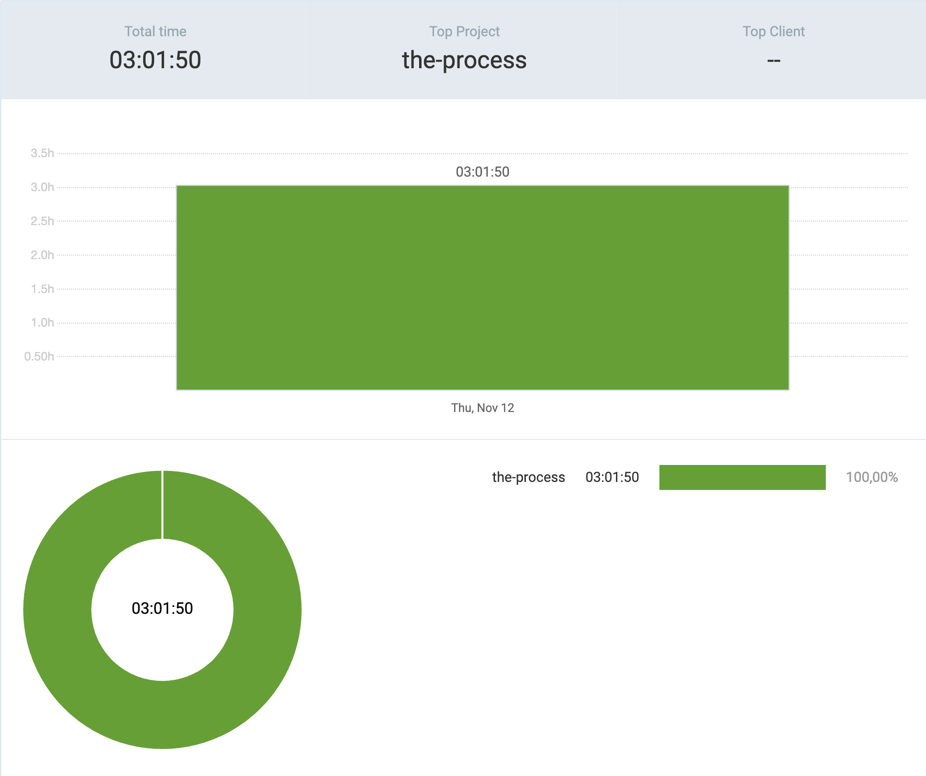

# 12th November 2026

## [the-process](https://github.com/kdklearns/the-process)

### `Neetcode 250`

- `Sliding Window` &rarr; Worked on two questions, including two approaches to Longest Substring Without Repeating Characters

**Total recorded solving time:** `02:42:21`

| S. No. | Problem | Topics | Level | TC | SC | Submissions | Time taken | Spaced Repetition | Note |
|--------|---------|--------|-------|----|----|-------------|------------|-------------------|------|
| [1](../../../../src/main/java/org/kdklearns/neetcode_250/m_03_sliding_window/q_03_longest_substring_without_repeating_characters/problem.md) | [Longest Substring Without Repeating Characters](https://leetcode.com/problems/longest-substring-without-repeating-characters/) | `Strings` `Hashing` `Sliding Window` | Medium | `O(N)` | `O(min(K, N))` | A1: 4 A2: 5 | A1: `01:26:06` A2: `00:49:19` | — | A1 (`HashSet`): Made me question my life choices. What in the world, bro! A2 (`HashMap`, jump past the previous occurrence): I am just a dot floating in the sky... |
| [2](../../../../src/main/java/org/kdklearns/neetcode_250/m_03_sliding_window/q_05_permutation_in_string/problem.md) | [Permutation in String](https://leetcode.com/problems/permutation-in-string/) | `Strings` `Frequency Counting` `Sliding Window` | Medium | `O(N)` | `O(1)` | 5 | `00:26:56` | — | Follow-up: Can I check each window without comparing all 26 letter counts? |

*Times use `HH:MM:SS` (hours:minutes:seconds). The total counts A1 and A2 separately. TC and SC denote time and space complexity. For Longest Substring, `K` is the alphabet size and `N` is the input length.*

## Commits

(_the-process_)

- `879d869` &rarr; sliding window > solved two questions: Q3, Q5
- `852c161` &rarr; test > sliding window > troubleshooted failed test cases