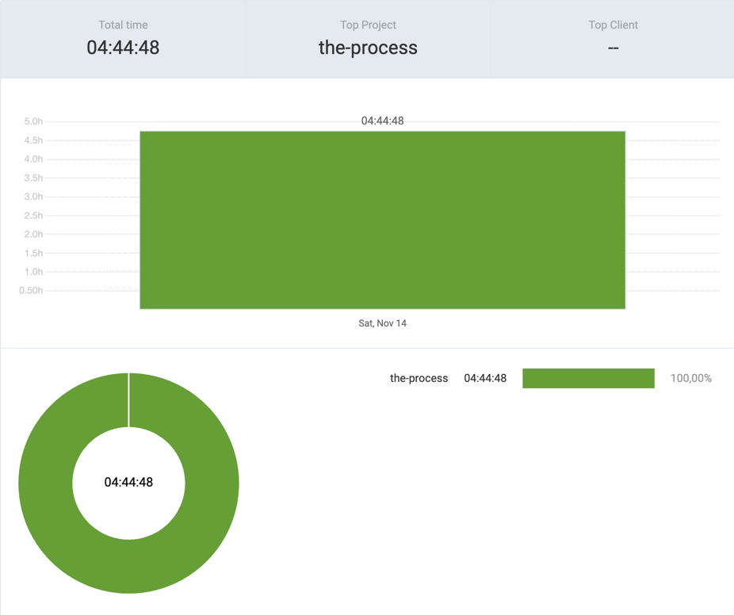

# 14th November 2026

## [the-process](https://github.com/kdklearns/the-process)

### `Neetcode 250`

- `Sliding Window` &rarr; Solved one question two ways and started another

**Total recorded solving time:** `03:19:03`

| S. No.                                                                                                                                | Problem                                                                                                           | Topics                                                | Level  | TC                                    | SC                       | Submissions    | Time taken                       | Spaced Repetition | Note                                                                                                                                                                                                                                                                                                                                       |
|---------------------------------------------------------------------------------------------------------------------------------------|-------------------------------------------------------------------------------------------------------------------|-------------------------------------------------------|--------|---------------------------------------|--------------------------|----------------|----------------------------------|-------------------|--------------------------------------------------------------------------------------------------------------------------------------------------------------------------------------------------------------------------------------------------------------------------------------------------------------------------------------------|
| [1](../../../../src/main/java/org/kdklearns/neetcode_250/m_03_sliding_window/q_09_sliding_window_maximum/problem.md)                  | [Sliding Window Maximum](https://leetcode.com/problems/sliding-window-maximum/)                                   | `Arrays` `Sliding Window` `TreeMap` `Monotonic Deque` | Hard   | A1: `O(N * log(K + 1))` A2: `O(N)` | A1: `O(K)` A2: `O(K)` | A1: 6 A2: 2 | A1: `01:20:25` A2: `01:14:23` | —                 | A1 (`TreeMap`): Failed enough tests with `TreeSet` to rethink the approach. Switched to a `TreeMap` to track duplicates. LeetCode AI suggested a monotonic deque for linear time. A2 (monotonic deque): Watched a video to understand the algorithm and pseudocode. Follow-up: What if the window size changes while numbers stream in? |
| [2](../../../../src/main/java/org/kdklearns/neetcode_250/m_03_sliding_window/q_04_longest_repeating_character_replacement/problem.md) | [Longest Repeating Character Replacement](https://leetcode.com/problems/longest-repeating-character-replacement/) | `Strings` `Frequency Counting` `Sliding Window`       | Medium | —                                     | —                        | —              | `00:44:15`                       | —                 | Still working out the algorithm.                                                                                                                                                                                                                                                                                                           |

*Times use `HH:MM:SS` (hours:minutes:seconds). The total counts A1 and A2 separately and includes time on the unfinished problem. TC and SC denote time and auxiliary space complexity; SC excludes the returned array. For Sliding Window Maximum, `N` is the array length and `K` is the window size.*

## Commits

(_the-process_)

- `8f55e74` &rarr; sliding window > solved one question in two ways, solving another: Q9
- `ef3e1b5` &rarr; test > troubleshooted failed test cases