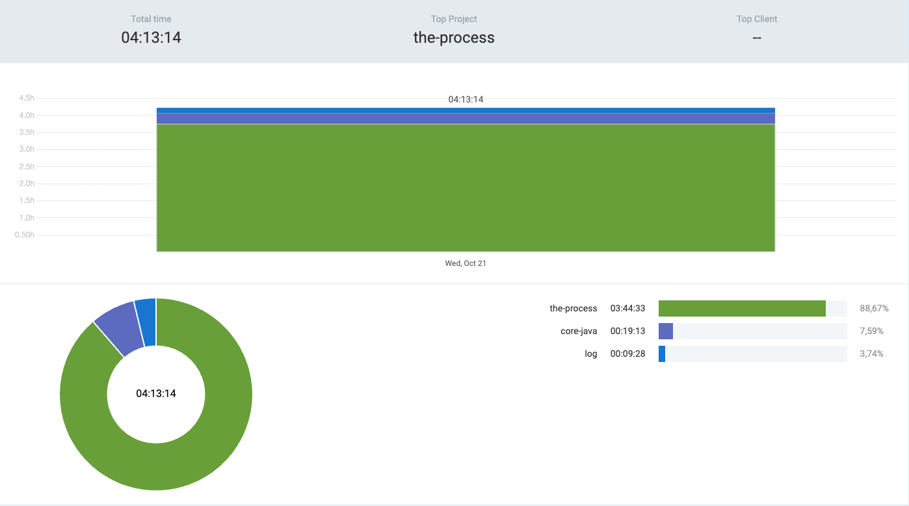

# 21st October 2026

## Neetcode 250
- `Arrays & Hashing` - Revised few of the old problems, re-attempted them and drafted their approaches for future revists

## Core Java
- `17. Absstraction & Polymorphism` - Revised notion doc notes
- `18. Autoboxing, Abstract Cla...` - Just started watching lecture

## Commits
- `79fb01a`
- `342b246`
- `5ded204`