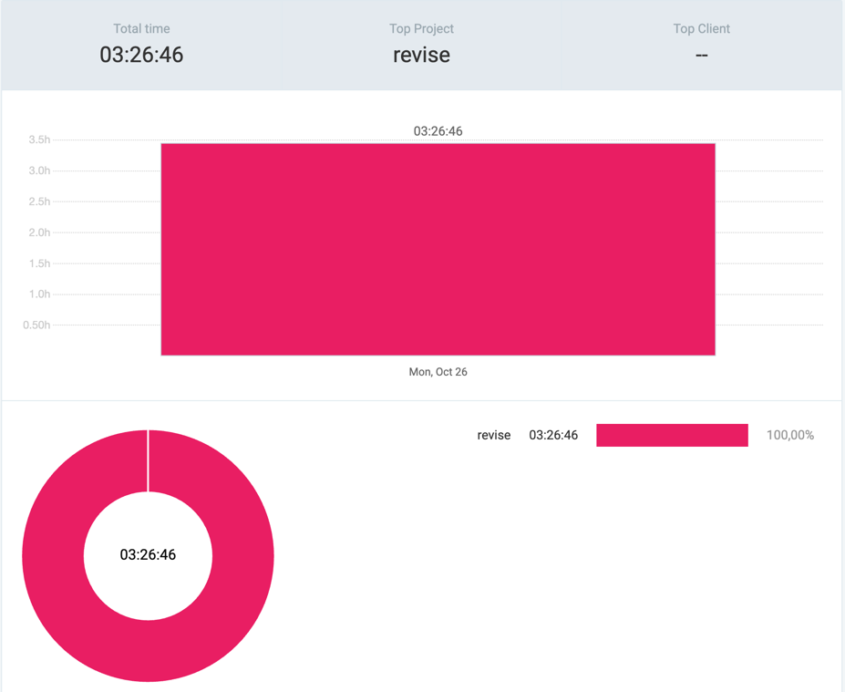

# 27th October 2026

## Data Structures
- `Linked List` - singly and doubly linked list with tests
- `Hashmap` - using arraylist and doubly linked list for chaining hashed indexes

## Commits
- `b12108c`
- `587e169`