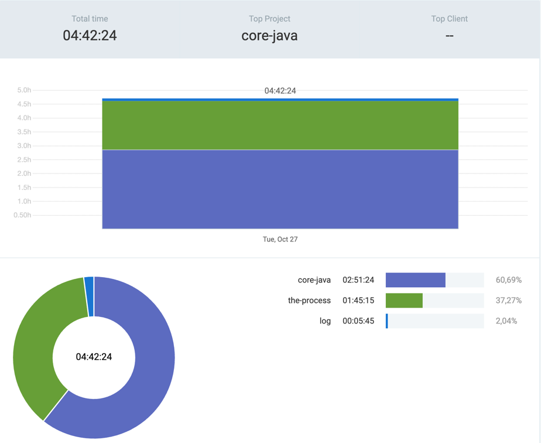

# 27th October 2026

## [the-process](https://github.com/kdklearns/the-process)
### `Data Structures`
- `Linked List` &rarr; Implemented a doubly linked generic list with tests
- `Hash Map` &rarr; Implemented hashmap using a doubly linked generic list with tests

### `Neetcode 250`
- `Arrays & Hashing` &rarr; Solved two questions

## [core-java](https://github.com/kdklearns/core-java)
- `27. Java Generics Deep Dive` &rarr; Completed
- `28. Wildcard in Generics...` &rarr; Just started watching

## Commits
(_the-process_)
- `b12108c`
- `587e169`
- `e78e5a0`
- `c4cdc6d`
- `6315a92`
- `7a1b91a`
- `2cf1b2d`
- `1138162`

(_core-java_)
- `102fc4c`